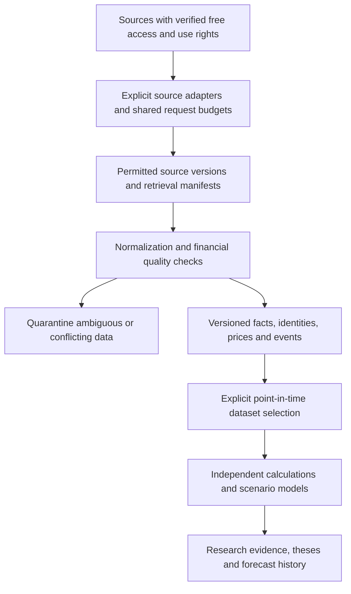

# Phase 1 — Financial Data & News Research

Research and source-access date: **2026-10-27**.

**Status: Phase 1 research documents reviewed and approved.** This approval does not begin integrations, Phase 2 implementation, or trading. Research involved no application code, dependency installation, infrastructure configuration, or account creation.

## 1. Recommended direction

Build a small, reproducible **primary-source research system** first. A useful €0 foundation exists for reported fundamentals, disclosures, macroeconomic context and news discovery. A complete free replacement for a commercial global point-in-time market database was **not established**.

Recommended data stack for the stated narrow uses:

| Layer | Proposed choice | Why and boundaries |
| --- | --- | --- |
| Reported company fundamentals and filings | **SEC EDGAR APIs and original filings** | Public, no account/key/payment; original reporting provenance. Begin with a bounded US-reporting universe, including foreign SEC filers where applicable. Standard XBRL aggregates need original-document reconciliation. [SEC API documentation](https://www.sec.gov/search-filings/edgar-application-programming-interfaces). |
| US economic indicators | **BLS and BEA directly** | Public statistical services and agency reuse policies; BLS has a keyless API and BEA documents email-based API registration. Historical revisions require specific archives, not today's values. [BLS API](https://www.bls.gov/developers/home.htm), [BEA API](https://apps.bea.gov/API/docs/index.htm). |
| European macro and informational FX | **ECB and selected Eurostat datasets** | Free public programmatic access, with source/dataset-specific reuse conditions. ECB documents historical versions; Eurostat explicitly keeps latest datasets without past-version history. [ECB data API](https://data.ecb.europa.eu/help/api/data), [Eurostat API](https://ec.europa.eu/eurostat/en/web/user-guides/data-browser/api-data-access/api-introduction). |
| Material announcements | **SEC filing notifications, official agency calendars/feeds, selected issuer IR RSS** | Direct evidence and explicit public notification mechanisms. Check issuer terms individually; a feed does not confer rights to all linked media or a complete archive. [SEC developer resources](https://www.sec.gov/about/developer-resources), [example issuer RSS](https://investor.nvidia.com/investor-resources/rss/default.aspx). |
| Broad news/industry discovery | **GDELT Project released metadata/raw files**, selectively | Project terms permit free research/commercial use and redistribution with attribution/link. This licenses its datasets, not publishers' full articles. Avoid billed cloud-query routes. [GDELT data](https://gdeltproject.org/data.html), [dataset terms](https://gdeltproject.org/about.html#termsofuse). |
| Local analysis tooling | **Python, pandas, DuckDB/Parquet**; optional EdgarTools | Modest local components with open-source licenses. Verify calculations and parser output against original evidence. Software does not confer data rights. [Framework comparison](research/ENGINEERING_FRAMEWORKS.md). |
| Equity prices, actions and analyst consensus | **No unconditional core provider selected** | Several free candidates merit narrower checks below. Their history, permissions or retention conditions remain insufficient for the full autonomous, reproducible use case. |

These recommendations concern free data/service access and local open-source software. They do not promise zero hardware, electricity, storage, or future AI-inference cost. No paid data route, trial, welcome-credit dependency, or automatic upgrade is part of the recommended core.

### Method and evidence

Three independent research workstreams investigated market data, news, and engineering/frameworks. The coordinator reviewed their reports, independently checked consequential findings against primary documentation, and added macroeconomic-source research. Detailed evidence remains in the repository:

- [Financial and market data](research/MARKET_DATA.md).
- [News and financial intelligence](research/NEWS_INTELLIGENCE.md).
- [Data engineering and research frameworks](research/ENGINEERING_FRAMEWORKS.md).
- [Macroeconomic data and verification](research/MACRO_DATA.md).

**Documented** means supported by inspected official documentation/terms; **observed** means a specific read-only retrieval succeeded or failed through our tool; **proposed** identifies our judgment; **unresolved** means permission or functionality was not established. Unknown is not the same as unavailable. Provider marketing claims are not measured completeness, accuracy or uptime. All quotas and terms must be rechecked before implementation.

## 2. Financial and market data comparisons

### Prices, fundamentals, earnings and estimates

The table compares free access, not the provider's full paid catalogue. Every conditional source is **outside the recommended core** until the specified questions are resolved at €0 without payment details, trials or automatic charges. Authentication/sign-up was reviewed from documentation, not completed.

| Provider | Free data/history and coverage | Authentication, quota, cadence | Suitability, rights and point-in-time limitations |
| --- | --- | --- | --- |
| **SEC EDGAR — recommend** | Filings from 1994/1995; XBRL mandate began 2009. CompanyFacts aggregates standard entity-wide concepts, not every custom/segment disclosure. Covers SEC filers, not every global issuer. | No key/account; identified User-Agent, maximum **10 requests/second**, coordinated across workers. Dissemination-driven APIs, nightly bulk. | Strong reported-evidence source. Frame outputs select last-filed facts; use original accessions/versions for historical analysis. Acceptance time is not exact public availability. [API](https://www.sec.gov/search-filings/edgar-application-programming-interfaces), [reuse/access/timing FAQ](https://www.sec.gov/about/webmaster-frequently-asked-questions). |
| **Twelve Data Basic — conditional price candidate** | US equities/ETFs, FX/crypto; actual free history and action entitlement need symbol/endpoint checks. International marketing coverage is not free entitlement. | $0 key, no-card Basic documented; **8 credits/minute, 800/day**, endpoint/symbol weights. Stocks marketed as real-time, feed completeness unmeasured. | Pricing includes internal non-display use, but free commercial use is prohibited and cache timeframes depend on documentation. Resolve retention, exact feed and free history before any pilot. [Pricing](https://twelvedata.com/pricing), [no-card Basic](https://twelvedata.com/forex), [terms §§2,16](https://twelvedata.com/terms). |
| **Alpaca Basic — conditional deeper US candidate** | Plan advertises stock history since 2016; live free data is IEX. General FAQ describes historical SIP requests ending at least 15 minutes ago. | Free Basic; paper-only account documented with email; key/secret, **200 historical requests/minute**. No brokerage funding/integration proposed. | Paper-only documentation says IEX-only while generic FAQ describes historical SIP; confirm exact entitlement and permitted retention. Partial live IEX coverage is not consolidated-market coverage. [Plan](https://docs.alpaca.markets/us/docs/about-market-data-api), [FAQ](https://docs.alpaca.markets/us/docs/market-data-faq), [paper account](https://docs.alpaca.markets/us/v1.4.2/docs/paper-trading). |
| **Alpha Vantage — conditional small secondary source** | Free compact daily response: **100 observations**; full daily history and Daily Adjusted are premium. Statements/earnings/estimates/listing functions are documented, with individual entitlement gaps. | Free lifetime email-based key, **25 requests/day**; statement updates generally follow earnings. | Personal/noncommercial scope; no general PIT archive established. Check ordinary free-key endpoints and retention; public demo does not prove free entitlement. [API](https://www.alphavantage.co/documentation/), [key/support](https://www.alphavantage.co/support/), [terms](https://www.alphavantage.co/terms_of_service/). |
| **EODHD Free — conditional short-history comparison** | Official free description: **past year**, personal use. Broad international/dead-stock catalogue does not prove those datasets are free. | Own key, explicit no card; **20 call-units/day**, plus a welcome bonus that must not be relied on; endpoint weights differ. | Not a deep backfill. Exact free endpoints, retention and intended-use permissions remain checks. [Free access and quota explanation](https://eodhd.com/financial-apis/quick-start-with-our-financial-data-apis). |
| **Financial Modeling Prep Basic — conditional** | Pricing/FAQ differ in how they describe free EOD and statement access; do not promise universal historical fundamentals. | $0 API key; **250 calls/day, 500 MB/trailing 30 days**. Payment-free flow not independently completed. | Resolve endpoint/symbol entitlement, history, retention and permission; no verified PIT guarantee. [Pricing](https://site.financialmodelingprep.com/pricing-plans), [FAQ](https://site.financialmodelingprep.com/faqs?code=calendar). |
| **Finnhub Free — conditional personal news/earnings supplement** | Pricing lists US coverage, company news **one year**, EPS surprises **four quarters**, earnings calendar **one month**. Do not import paid OHLC/statement/consensus promises into free tier. | $0 key, **60 calls/minute**; news/calendar marketed as real-time. No-card registration not established. | Terms restrict business use/sharing of derived results and require deletion when subscription ends. Not a cleared persistent fundamentals source. [Pricing](https://finnhub.io/pricing), [terms](https://finnhub.io/terms-of-service). |
| **Massive Basic, formerly Polygon — exclude autonomous analysis under default terms** | Free **two-year** EOD US bars/actions; product-wide decades of history are not free. | Explicit $0/no-card; key, **5 requests/minute**. | Incorporated market-data terms default to display-only; non-display strategies need licensing. Free accessibility does not clear automated investment analysis. [Basic pricing](https://massive.com/pricing), [market-data terms §§2,5,8](https://massive.com/legal/market-data-terms-of-service). |
| **Tiingo Starter — exclude durable research storage** | Advertises historical EOD prices/actions; actual history varies. | $0 token; documented quotas include **50/hour, 1,000/day**, plus symbol/bandwidth caps. | Current §1.6 bars persistent storage of both data and derived results on Starter/Trial. Incompatible with reproducible local storage. [Pricing](https://www.tiingo.com/pricing), [current terms](https://app.tiingo.com/tos/). |
| **Yahoo/yfinance — hold outside unattended stack** | Convenient global prices/actions/financial interfaces; no verified complete delisted or historical-consensus archive. | Unofficial wrapper; no stable official quota/SLA established. | Software is open-source; underlying automation/data-use rights remain separate. Yahoo terms restrict automated collection without permission. [Project caveat](https://ranaroussi.github.io/yfinance/), [Yahoo terms](https://legal.yahoo.com/us/en/yahoo/terms/otos/index.html). |
| **Stooq — unresolved** | Historical download service exists, but primary pages presented verification challenges. | Current quota, automation rights, retention and completeness could not be established. | Do not bypass access controls or treat public CSV URLs as a reuse license. [Official download page](https://stooq.com/db/h/), [terms location](https://stooq.com/t/?i=5). |
| **Nasdaq Data Link WIKI — exclude ongoing source** | Historical community US equity dataset, unsupported since **April 11, 2018**; provider warns against investment/analysis use. | Current delivery entitlement not verified; no ongoing updates. | Cannot serve current monitoring or a validated survivorship-free benchmark. [Official catalogue](https://data.nasdaq.com/databases/WIKIP). |

Full licensing, endpoint-history and corporate-action evidence appears in [the market workstream](research/MARKET_DATA.md). No commercial source above was shown to provide a comprehensive free historical database of all prices, revisions, delisting proceeds, forecasts and universe membership.

### International markets and identifiers

EU **ESEF** annual XHTML/iXBRL reporting supports future company research but is a reporting standard, not one worldwide API; national repositories/issuers have separate access conditions. UK **Companies House** offers filing history/accounts documents via a registered key, with **600 requests/5 minutes**; it is not a standardized exchange-price feed. Korea **OpenDART** and Japan **J-Quants** merit market-specific follow-up, with eligibility, delayed/expiring free access and rights checked before recommendation. [ESMA ESEF](https://www.esma.europa.eu/issuer-disclosure/electronic-reporting), [Companies House limits](https://developer.company-information.service.gov.uk/developer-guidelines/), [OpenDART](https://engopendart.fss.or.kr/intro/main.do), [J-Quants plans](https://jpx-jquants.com/en/spec/data-spec).

Current exchange symbol directories, such as Nasdaq Trader's, help identify instruments but do not reconstruct historical membership. Model issuer, security/share class, listing/venue, symbol history, currency and effective dates separately. SEC's current ticker map is not a historical global security master. [Nasdaq directory definitions](https://www.nasdaqtrader.com/trader.aspx?id=symboldirdefs), [SEC ticker-map caveats](https://www.sec.gov/about/webmaster-frequently-asked-questions).

### Valuation inputs and forecasts

Use filings for reported earnings, cash flows, debt, cash, and share context; calculate ratios locally with explicit fiscal periods, currency, units and definitions. Cash-flow statements often report year-to-date amounts. Weighted-average EPS shares differ from date-specific shares outstanding. Historical market capitalization requires a compatible historical price and share count, which this report does not claim to supply completely.

DCF scenarios remain **our projections**. Align FCFF with WACC and FCFE with cost of equity; document discounting and terminal-value assumptions and independently check calculations. FinanceToolkit is a possible transparent reference, not proof of correct inputs or accounting comparability. [DCF source and assumptions](https://raw.githubusercontent.com/JerBouma/FinanceToolkit/main/financetoolkit/models/intrinsic_model.py).

Issuer guidance, analyst consensus, realized EPS, and a provider's later surprise calculation are different datasets. No comprehensive free historically timestamped analyst EPS/revenue consensus or price-target archive was verified. Proceed with labeled own projections; leave unsupported consensus fields unavailable. Do not reconstruct pre-earnings forecasts from subsequent results.

## 3. News, releases and economic indicators

### News sources

| Source | Free access/history and limits | Recommendation and key limitation |
| --- | --- | --- |
| **SEC filings and selected issuer RSS** | Public notifications without paid enrollment; issuer history/quotas vary. | Core for primary announcements, subject to source terms. Preserve originals/amendments and distinguish management statements from independent evidence. [SEC resources](https://www.sec.gov/about/developer-resources), [issuer RSS example](https://investor.nvidia.com/investor-resources/rss/default.aspx). |
| **GDELT Project datasets** | Keyless raw downloads/public API examples; 2.0 files update **15-minute** intervals. Events reach 1979; 2.0/GKG and DOC have different histories. Numerical API quota/SLA unverified. | Recommended metadata discovery. Keep attribution, deduplicate syndication, validate entity/tone extraction. No publisher full-text license. [Data](https://gdeltproject.org/data.html), [terms](https://gdeltproject.org/about.html#termsofuse). |
| **GDELT DOC API** | Public keyword/article-metadata search; result caps and historical-mode semantics constrain recall. | Useful exploration; original rolling-three-month docs were amended by a 2018 fixed-2017-start announcement with mode/window limits. Current historical endpoint behavior remains untested. [Original reference](https://blog.gdeltproject.org/gdelt-doc-2-0-api-debuts/), [later update](https://blog.gdeltproject.org/doc-2-0-updates-1-5-year-searching-and-updated-mobile-interface/). |
| **Marketaux** | Explicit no-billing free token; **100 requests/day, three articles/request**; free historical depth unverified. | Hold: useful financial entity metadata, but API functionality and generic automation/commercial terms need reconciliation. [Docs](https://www.marketaux.com/documentation), [pricing](https://www.marketaux.com/pricing), [terms](https://www.marketaux.com/tos). |
| **NewsData.io** | No-card free key; **200 credits/day**, delayed **12 hours**, past **48 hours** according to free docs. | Conditional personal/testing candidate; not a comprehensive real-time/archive source or publisher-rights grant. [Pricing](https://newsdata.io/pricing), [docs](https://newsdata.io/documentation), [terms](https://newsdata.io/terms). |
| **NewsAPI.org** | Developer $0, **100/day**, **24-hour delay**, one-month history. | Exclude operational use: free tier disallows staging/production, including internal production. Full article text not supplied. [Pricing/FAQ](https://newsapi.org/pricing). |
| **Guardian Open Platform** | Noncommercial developer key, **one/second, 500/day**, publisher archive from 1999. | Not an unconditional investment-platform source. Commercial mining, sentiment and derived services require commercial access. [Access](https://open-platform.theguardian.com/access/), [archive](https://open-platform.theguardian.com/). |

Official BLS/BEA/Fed/ECB/Eurostat calendars and feeds provide events and actual releases, not global historical market consensus. For industry and competitor intelligence, combine issuer business/risk/MD&A disclosures with GDELT candidates and appropriate public statistics; a procurement notice or management forecast is not realized revenue. Detailed source links and monitoring design are in [the news report](research/NEWS_INTELLIGENCE.md).

### Macroeconomic data

| Source | Free access, limits and history | Licensing, quality and historical availability |
| --- | --- | --- |
| **BLS — core** | Keyless v1: **25 queries/day**, 25 series and 10 years/query. Optional registered v2: **500/day**, 50 series and 20 years/query. Both **50 requests/10 seconds**. History is series-specific; observation cadence differs from release timing. | Statistical material public domain with attribution requested; API citation/disclaimer conditions apply. Latest API is not a universal vintage archive; CES has specific vintage tables. [FAQ](https://www.bls.gov/developers/api_FAQs.htm), [terms](https://www.bls.gov/developers/termsOfService.htm), [CES vintages](https://www.bls.gov/web/empsit/cesvininfo.htm). |
| **BEA — core** | Email-activated API UserID; no payment step in documented registration. **100 requests/minute, 100 MB/minute, 30 errors/minute**. GDP annual/quarterly histories go back to 1929/1947; other datasets vary. | Public domain unless otherwise stated. Use archived releases/vintage files where available; current tables are revised. [Guide pp. 1,4–6](https://apps.bea.gov/api/_pdf/bea_web_service_api_user_guide.pdf), [GDP archives](https://www.bea.gov/data/gdp/gross-domestic-product), [reuse](https://www.bea.gov/help/faq/147). |
| **ECB — core, selected statistics** | Public keyless SDMX examples, no paid setup; numerical quota not verified. Series-specific history/schedules. Reference FX normally around **16:00 CET working days**, informational rather than tradable. | Free ESCB-statistic reuse with attribution and source conditions; third-party data excluded. `includeHistory` exposes previous versions and `updatedAfter` changed/deleted values; verify each dataflow. [API](https://data.ecb.europa.eu/help/api/data), [reuse](https://www.ecb.europa.eu/stats/ecb_statistics/governance_and_quality_framework/html/usage_policy.en.html), [FX](https://www.ecb.europa.eu/stats/policy_and_exchange_rates/euro_reference_exchange_rates/html/index.en.html). |
| **Eurostat — core, selected European datasets** | Free REST, no account/key in public examples; database updates twice daily if changes exist. No numerical request quota verified. | Reuse with attribution and exceptions, including some non-European/trade data for commercial use. Database explicitly provides **latest versions without historical versioning**. Preserve permitted future snapshots. [API](https://ec.europa.eu/eurostat/en/web/user-guides/data-browser/api-data-access/api-introduction), [reuse exceptions](https://ec.europa.eu/eurostat/help/copyright-notice). |
| **FRED/ALFRED — permission hold for durable pipeline** | Free email/password account and v1 key; documented **120 requests/minute**. Vintages available for selected series. | Current full legal terms restrict API AI-development/storage and MCP caching, unlike older API terms. Do not assume free keys or MCP availability authorize our warehouse. [Current terms](https://fred.stlouisfed.org/legal/), [v1 limits](https://fred.stlouisfed.org/docs/api/fred/errors.html), [older API terms](https://fred.stlouisfed.org/docs/api/terms_of_use.html). |
| **World Bank Indicators — optional context** | V2 no auth; no-cost datasets, histories/frequencies vary, often annual. Numerical quota unverified. | Review each catalog license/third-party exception; current general terms and dataset-specific terms differ. No general vintage guarantee established. [API](https://datahelpdesk.worldbank.org/knowledgebase/articles/889392-about-the-indicators-api-documentation), [dataset summary](https://data.worldbank.org/summary-terms-of-use), [catalog FAQ](https://datacatalog.worldbank.org/faq). |

The [macro report](research/MACRO_DATA.md) details FRED's legal/documentation conflict, BEA/BLS vintage alternatives, and the Philadelphia Fed RTDSM as a supplementary research candidate. No source is assumed error-free because it is official. Preserve seasonal adjustments, base years, release/revision dates and statistical-method changes.

## 4. Financial analysis and storage frameworks

Local open-source packages can be used without a data subscription; data must be supplied under its own permissions. History, API authentication, request rates and PIT correctness are properties of the data path, not automatically of a calculation package.

| Candidate and license evidence | Proposed role | Tradeoff and adoption order |
| --- | --- | --- |
| **DuckDB, MIT**; **Arrow/PyArrow, Apache-2.0** | Embedded analysis over typed Parquet files/local catalog. | Strong initial candidates; keep one coordinated writer and snapshot manifests. No service required; no benchmark performed. [DuckDB FAQ](https://duckdb.org/faq), [Parquet](https://duckdb.org/docs/2.0/data/parquet/overview), [Arrow license](https://raw.githubusercontent.com/apache/arrow/main/LICENSE.txt). |
| **pandas, BSD-3-Clause** | Normalization, fiscal alignment and explicit temporal joins. | Initial candidate; sorting, vintage eligibility and memory constraints remain our responsibility. [License](https://github.com/pandas-dev/pandas/blob/main/LICENSE), [backward as-of joins](https://pandas.pydata.org/docs/reference/api/pandas.merge_asof.html). |
| **SQLite, public domain** | Optional small operational catalog. | Add only if simpler than keeping one existing catalog. [Use cases](https://sqlite.org/whentouse.html), [dedication](https://sqlite.org/copyright.html). |
| **EdgarTools, MIT** | Optional SEC document/XBRL parsing. | Validate derived/standardized/TTM fields against original SEC evidence; library fair-access defaults do not coordinate every other worker. [Project](https://github.com/dgunning/edgartools), [license](https://raw.githubusercontent.com/dgunning/edgartools/main/LICENSE.txt). |
| **FinanceToolkit, MIT** | Inspectable ratios/DCF on externally supplied approved inputs. | Defaults can acquire FMP and fall back to Yahoo. Prevent implicit acquisition and independently check formulas/mappings. [Project/default behavior](https://github.com/JerBouma/FinanceToolkit), [license](https://github.com/JerBouma/FinanceToolkit/blob/main/LICENSE.txt). |
| **SciPy, BSD; statsmodels, modified BSD** | Later numerical methods/statistical baselines. | Add for a defined method; neither supplies valid forecasts or point-in-time data. [SciPy](https://scipy.org/), [statsmodels](https://www.statsmodels.org/stable/index.html). |
| **QuantLib, modified BSD** | Later instrument valuation, curves and conventions. | Useful when justified by instrument scope; native core and market calibration add complexity. [Project/license](https://www.quantlib.org/license.shtml). |
| **OpenBB, current develop Apache-2.0** | Potential later multi-provider orchestration. | Verify selected release license; historical AGPL descriptions are stale for inspected branch. Connectors may still require paid/restricted data. [Current license](https://raw.githubusercontent.com/OpenBB-finance/OpenBB/develop/LICENSE), [README](https://raw.githubusercontent.com/OpenBB-finance/OpenBB/develop/README.md). |
| **yfinance, Apache-2.0 software** | Exploratory wrapper only if underlying access is permitted. | Not a source license or stable unattended backbone. [Project disclaimer](https://github.com/ranaroussi/yfinance). |

Current docs, source files and release histories were inspected; compatibility, performance, package security and runtime financial correctness were not tested. Context7 informed the library review; first-party links remain the independently inspectable evidence. See [framework details and validation plan](research/ENGINEERING_FRAMEWORKS.md).

## 5. Independent verification and evidence limits

| Important finding | Independent check | Result and consequence |
| --- | --- | --- |
| SEC is genuinely free/public with bounded automation | Coordinator inspected API docs and [webmaster FAQ](https://www.sec.gov/about/webmaster-frequently-asked-questions) independently of market/news agents. | No auth/key; 10/second ceiling. FAQ permits EDGAR reuse, but government authorship must not be assumed for all issuer/third-party attachments. |
| SEC timing is not exact first availability | Coordinator compared API update descriptions with FAQ's 1–3-minute typical document lag and explicit lack of a first-public timestamp. | Do not treat acceptance or reporting period as a certified tradable timestamp. Conservative historical eligibility rules remain necessary. |
| Tiingo free retention is unsuitable | Market agent inspected terms; coordinator independently retrieved [current terms](https://app.tiingo.com/tos/) through a live Firecrawl fetch, HTTP 200. | October 6, 2026 revision, §1.6: data and derived results cannot persist on Starter/Trial. Exclude this archive path. |
| Massive free access does not clear non-display analysis | Coordinator followed individual terms into [incorporated market-data terms](https://massive.com/legal/market-data-terms-of-service) independently. | Default display-only and non-display/derived-strategy restrictions are material despite no-card Basic marketing. |
| FRED technical usefulness does not clear our warehouse | Coordinator and engineering agent independently inspected [current full terms](https://fred.stlouisfed.org/legal/) and compared older API terms. | Current API (k)/(l), general (p), MCP (k) restrictions conflict with intended storage/AI workflow; hold for applicable no-cost permission. |
| NewsAPI/Guardian free plans do not support an unconditional stack | Coordinator reread [NewsAPI pricing/FAQ](https://newsapi.org/pricing) and [Guardian access](https://open-platform.theguardian.com/access/) independently of news agent. | Internal-production prohibition and commercial-mining requirements change eligibility. |
| GDELT has reusable datasets, different histories | Coordinator checked [Project terms](https://gdeltproject.org/about.html#termsofuse) and [2018 DOC update](https://blog.gdeltproject.org/doc-2-0-updates-1-5-year-searching-and-updated-mobile-interface/) independently. | Recommend released metadata; do not claim all full articles or a verified current DOC history horizon. |
| Frameworks can hide data acquisition/license changes | Coordinator inspected current FinanceToolkit README/DCF source, EdgarTools project and OpenBB license independently of engineering agent. | Use approved local inputs; pin chosen release and audit provider calls. |

Additional observations: existing FRED MCP search/metadata calls returned structured responses; no raw payload was saved in this repository. Some browser API probes for SEC, BLS, ECB and GDELT were inaccessible through the tool, so no provider outage or endpoint failure is inferred. ECB docs intermittently failed browser retrieval but succeeded with a live Firecrawl fetch. No authenticated provider integration, long-term uptime measurement, quota stress test, representative numeric data audit or package benchmark was performed. This is evidence-backed source selection research, not a tested integration matrix.

## 6. Proposed conceptual data architecture

Start with local files and one catalog; Parquet/DuckDB is a candidate, not a mandate. Keep authored reports and small reviewed synthetic fixtures in Git, and permitted raw datasets/caches/generated runs in ignored local storage. No queues, services, cloud accounts or execution integration are needed for the first slice.

Minimum conceptual records:

- **Source contract:** exact endpoint/product/plan, free/no-card evidence, permitted purpose/automation/retention/derived use, attribution, quotas, terms date/URL, recheck date and status. Stop on unsuitable changes; never silently upgrade or change providers.
- **Retrieval:** request parameters with secrets removed, source ID/URL, retrieval UTC, permitted status/headers, content hash/path, pagination completeness, schema/parser version and retention rule. Hashing is not a substitute for raw evidence or a data license.
- **Identity:** issuer, security/share class and venue identifiers, currency, current and historical symbols with validity intervals; memberships and delisting events separately.
- **Reported fact:** original tag/context, value/precision/scale/unit/currency, instant or period interval, fiscal label, dimensions/accounting basis, accession, publication evidence, revision/vintage, and reported/estimate/projection classification.
- **Price/action or news event:** venue/session, raw/adjusted policy and adjustment vintage; corporate-action announcement/ex/effective/pay dates; news ID/URL, publication/update/first-seen times, entity confidence, corrections and permitted content scope.
- **Research run:** hypothesis, input snapshot, availability mode, code/configuration versions, transformations/formulas, model/scenario assumptions, random seed where relevant, outputs, contradictions and limitations.

Keep **observation period**, **public/provider availability**, **our retrieval**, and **processing/decision eligibility** separate. A retrospective public-information reconstruction may use evidenced old release times even when downloaded today, and must disclose assumptions. Actual pipeline replay also requires that we had ingested and processed the version. Unknown or date-only publication requires documented conservative eligibility or exclusion, not fabricated clock precision.

Retain each permitted restatement/revision as another version. A current CompanyFacts result, latest Eurostat table, corrected article or retrospectively adjusted price must not silently rewrite a prior research run. Original prices, split adjustments and dividend-inclusive total returns must remain distinct. Full-text analysis requires separate content rights; discovering an article URL does not authorize its collection. Keep external text untrusted and separate from instructions, credentials or execution authority.

## 7. Coverage gaps and implications

| Gap | Practical effect |
| --- | --- |
| No verified complete free global long-history price/action/delisting dataset with required permissions | Start with fundamentals/disclosures. Keep price research conditional; no survivorship-free or investable-universe backtest claim. Missing terminal prices/proceeds are not zero returns. |
| No comprehensive historical analyst consensus and forecast-vintage archive | Own scenarios can proceed, labeled as projections. Consensus-surprise strategies are deferred. |
| No comprehensive licensed historical financial-news/full-transcript archive | Use primary releases and released metadata; retain permissible evidence prospectively. News-signal backtests describe their observed corpus and gaps. |
| Latest data versus true historical versions | Agency-specific archives and filing evidence are required. Future snapshots cannot reconstruct unseen earlier states. |
| Free personal/development use differs from organizational, commercial, non-display and AI use | Several attractive sources remain outside the core; do not treat private deployment or absence of redistribution as automatic permission. |
| No measured source completeness or library correctness | Require bounded sample reconciliation and meaningful temporal/numerical tests in Phase 2 before research claims. |

These are findings of this search, not proof that suitable free alternatives cannot exist. International expansion, high-frequency research and deep survivorship-aware history require separate evidence and may need reduced scope to remain at €0.

## 8. Practical implementation sequence for Phase 2

This is a proposal for later approval; no step has been implemented.

1. **Approve a narrow universe and research cadence.** Start with a small SEC-filer watchlist and US/euro-area macro releases. Specify personal versus organizational use, target countries, history, acceptable delay and output audience. This determines rights and coverage requirements.
2. **Establish source permissions and local project tooling.** Recheck exact public endpoints/free keys and retention/analysis rights; add the reviewed `.gitignore`, dependency pins and reproduction instructions when implementation is authorized. Leave conditional/restricted providers disabled.
3. **Implement one SEC acquisition slice.** Shared identity/throttle, bounded pagination, idempotent checkpoints, original filings and retrieval manifests. Reconcile a few facts with original statements, including one amended filing and differing fiscal calendars. Verify standard/custom taxonomy limitations and source errors.
4. **Build the temporal/financial normalization layer.** Test periods/units/currencies, standalone versus year-to-date flows, share definitions and correction handling. Prove a later filing/restatement cannot enter an earlier as-of result. Distinguish public reconstruction from actual pipeline replay.
5. **Add direct macro sources and announcement monitoring.** Use BLS/BEA/ECB/Eurostat under their relevant conditions; reconcile one revised observation to its earlier release/archive. Validate ECB history/delta handling. Preserve permissible future snapshots where earlier versions are unavailable. Add bounded official/issuer notifications with stale-feed and duplicate detection.
6. **Evaluate price candidates behind explicit gates.** First resolve Twelve Data cache/history/feed rights and Alpaca paper-only historical-feed/retention eligibility, or use another source whose rights are demonstrated. Then test a small split/dividend/delisting sample. If no candidate clears the gates at €0, retain the gap and continue primary-source research without price-dependent claims.
7. **Add selected GDELT metadata and local calculations.** Validate historical search behavior, truncation, entity matching and syndication. Check ratios/DCF on hand-worked fixtures and independent formulas; inspect optional FinanceToolkit/EdgarTools behavior with unapproved network acquisition disabled.
8. **Deliver one reproducible research example.** Rerun from permitted pinned inputs offline, with provenance, assumptions, sensitivity/scenarios and leakage checks. Report coverage limitations and benchmark definitions. Forecasting/backtests, portfolio automation and all execution functionality remain separately scoped future work.

Completion gates should test observable outcomes: consistent accounting identities where applicable, numeric tolerances explained, correct missing/error behavior, complete bounded downloads, preserved revisions, an earlier as-of query unaffected by a later correction, and no unapproved provider calls. Agreement between two wrappers of one upstream source is not independent validation.

The Phase 1 research documents are approved for version control. Implementation of the proposed Phase 2 scope and provider integrations remains separately authorized work.
