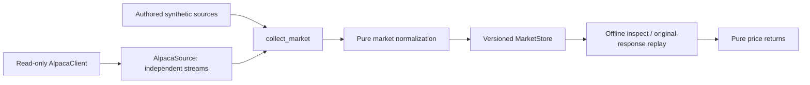

# Market data — implemented interfaces and limits

**Milestone 3A is approved/published in `85c8575`. Milestone 3B's live Alpaca adapter is implemented and validated for independent review, with no new commit or push.** The latest user scope authorizes read-only historical SIP and private noncommercial local persistence subject to provider terms. Indefinite post-termination retention uncertainty alone no longer blocks implementation. This is not verified contractual clearance or public redistribution permission. See [access research](ALPACA_ACCESS.md), [provider decision](MARKET_DATA_PROVIDER_DECISION.md) and [live validation](ALPACA_LIVE_VALIDATION.md).

## Existing architecture and separation

The project is a standard-library Python package, with no ORM, server or new dependency. SEC collection and the Financial Analysis Engine remain separate and unchanged. Market storage composes existing atomic byte/JSON writers and owns its POSIX lock, raising `MarketDataError`; it does not change SEC's `SecError` contract. CIK is an issuer identifier, not a security/share-class identifier.



| Interface | Contract |
| --- | --- |
| `AlpacaClient.get(stream, params)` | Fixed GET bars/actions and paper-host read-only asset/calendar routes. Header-only authentication; shared per-client rate/retry/request budget; exact bytes and safe metadata; no orders, paid/recent feeds or fallback. |
| `collect_alpaca(client, store, symbols, start, end, ...)` | Explicit 1–20-symbol watchlist using one client. Resolve observed asset UUIDs, then reuse the existing collection/cache/snapshot interface. |
| `AlpacaSource.prepare(start,end,request_budget,previous)` | Under the market lock, after cache lookup: validate current identity, retrieve calendar, traverse independent price and process-date action pages, normalize a canonical envelope and receipt bound. |
| `normalize_bundle` / `normalize_live_bundle` | Pure synthetic/real validation with explicit labels, Decimal strings, units, sessions, adjustments, action evidence and original observation times. Validation is not a permission grant. |
| `MarketStore.inspect(identifier, as_of, provider, feed, adjustment, adjustment_as_of)` | Select an unambiguous published snapshot and latest eligible observations; expose provenance, revisions, quality and original source references without network or credentials. |
| `replay_alpaca_snapshot(store, manifest)` | Verify hashes, reparse saved original endpoint bodies, compare canonical evidence and reproduce retained observation IDs/times, including prior update groups. No network. |
| `split_price_return` | Compatible raw endpoints plus complete scoped action evidence. Missing action coverage remains an explicit failure. |
| `adjusted_price_return` | Compatible provider split-adjusted endpoints from one acquisition vintage. Ratio of supplied closes, excluding cash dividends and any total-return claim. |

The earlier `JsonFileSource` and `AlpacaReplaySource` remain explicitly synthetic fixture adapters. The temporary `probe_access` remains a separate memory-only diagnostic, not a persistence source. Previous six Gemini finding dispositions and adversarial interruption results remain in [the 3A review](MARKET_DATA_REVIEW_RESPONSE.md) and [validation](MARKET_DATA_ADVERSARIAL_VALIDATION.md).

## Provider streams and identity

Alpaca historical bars use `data.alpaca.markets/v2/stocks/bars`; actions use **`/v1/corporate-actions`**, independently paginated by process date. Calendar and asset lookup are read-only routes on `paper-api.alpaca.markets/v2`. There is no live-trading host, order route, arbitrary URL/method or plan-upgrade interface. Query fields are allowlisted; credentials cannot enter query/history metadata. All sources explicitly select `sip` or `iex`; no silent substitution is allowed. The Basic historical SIP selection follows the user's latest private-use scope and documented/observed historical access; conflicting paper-account language remains unverified account-specific contract context.

Instrument metadata records observed asset UUID, symbol, listing MIC, requested USD quote currency and `America/New_York`. Asset responses must match the selected security; a changed UUID/symbol fails rather than relabeling old history. Current asset metadata does not establish historical ticker mapping, listing venue, IPO/delisting dates or survivor-free universe membership. `asof=-` disables provider name stitching; historic symbol changes require separate evidenced handling.

Daily `t` is New York midnight at the aggregation's left edge, **not publication**. Calendar local open/close times preserve DST, holidays, early and extraordinary closures. A full historical day plus a conservative feed delay is required. Missing expected bars are reported, never fabricated or assigned zero volume. Calendar evidence is not a listing-life model or a guarantee of provider data completeness.

The current US-equity model requires integer-valued nonnegative volume; a fractional-volume feed/representation fails explicitly rather than being rounded. This is not a universal volume assumption for future providers or asset classes.

## Storage, caching and recovery

Default ignored store, independent of SEC configuration:

```text
data/market/
  raw/<sha256>.json
  normalized/<sha256>.json
  datasets/<series-hash>/snapshots/<uuid>/manifest.json
  datasets/<series-hash>/latest.json
  datasets/<series-hash>/status.json
  verification/                 # Local reports and reproducible real-data checks
```

Canonical raw envelopes contain the **exact original UTF-8 endpoint bodies**, their own hashes, stream/query/cursor/receipt metadata and safe headers. No authentication or account-sensitive errors are retained. Normalized observations point back to those envelopes. Manifests preserve normalizer version, retrieval/completion times, data/source hashes and published predecessor. Only the atomic latest-pointer chain is queryable; interrupted temporaries/orphans do not become valid snapshots. Load/cache/replay verify hashes. Hardware power-loss durability and protection against hostile manifest rewriting are not claimed.

Series keys separate instrument metadata, provider/feed, raw/adjusted mode, anchor and real versus synthetic evidence. Market normalizer **version 3** retains v2 synthetic series keys and old snapshots; earlier cache versions trigger new normalization. Old prototype real adjusted snapshots without acquisition-vintage evidence remain readable/replayable, but cannot authorize mixed-vintage return calculations. No old files are silently rewritten.

Raw updates fetch a default seven-calendar-day overlap, preserve changes as new observations and deduplicate only consecutive unchanged values. A→B→A is three occurrences. Missing refreshed raw bars retain their original evidence/time and get `unconfirmed_refresh_sessions`. Removed/changed calendar sessions require explicit reconciliation. Cache hits keep original data age; failed publication leaves the previous pointer intact. Attempt status is separate from last successful retrieval.

One client shares two-request/second throttling, retries and the invocation request budget across all watchlist endpoints. Same-store collection locks coordinate jobs. This does not coordinate unrelated API clients or different stores/account traffic; no account-wide quota service is installed. HTTP 401/403, redirects, exhausted budgets and long/invalid cooldowns fail without bypasses or paid fallback. Safe rate headers and Retry-After are honored; error bodies are not read.

## Corporate actions and completeness

Initial process coverage starts at the explicit `--process-start` (default 2016-01-01) and ends at actual retrieval day. Later polls resume from the last successful process end minus `--action-overlap-days` (default seven). Price ranges and process ranges are independent: a newly processed correction may have an older ex-date outside the price update. Only published successful snapshots advance that cursor. `--refresh` rechecks the full configured historical process range as well as the supplied price range. There is no guaranteed correction horizon; late arrivals/edits retaining older process dates require periodic full reconciliation.

Supported forward/reverse splits preserve original numerator/denominator, new/old ratio, provider ID/subtype and process/ex/record/payable dates. Cash dividends preserve reported amounts and dates. For real actions, `currency` binds the **series quote currency**; **`cash_currency` is the reported currency of the dividend amount**, and may be `None` with `currency_status=unknown`. Never assume that an unknown cash amount is USD merely because the quoted stock is in USD. Missing payment/record dates are not inferred. Legitimate payment-before-ex-date special distributions remain valid. Currency conversion and due-bill entitlement are not modeled.

Unsupported/incomplete action records remain in original response evidence with explicit diagnostics; they are not silently translated into cash dividends or splits. Complete process pagination and `data_quality=all/complete` do not certify an exhaustive ex-date ledger. The live source therefore keeps **action completeness false**. Missing known records are not guessed as cancellations; scoped `unconfirmed_refresh_actions` diagnostics flag absent prior records in a reconciled process window. Retractions, changing event IDs, complex reorganizations and cash-merger accounting remain unresolved.

Existing synthetic complete-window proofs retain original source/observation claims, union only adjacent/overlapping verified dates, and preserve gaps. Incomplete updates invalidate overlapping proof in the new view without changing earlier cutoffs. Integrity fingerprints prove internal consistency, not external truth or licensing. No synthetic proof is transferred into real market coverage.

## Adjustment vintages and financial interpretation

Raw, split-adjusted and dividend-adjusted values stay distinct. Split adjustments affect prices and volume; dividend mode affects price. `all`, spin-off and combination modes are intentionally unsupported until their full treatment is implemented. Provider current adjusted data has no documented arbitrary historical-knowledge freeze; symbol `asof` is not such a freeze.

Every real adjusted refresh covers the **union of requested and already stored history**, even for a narrow caller request. Omission of any previously stored adjusted observation aborts publication. An acquisition-vintage fingerprint of original bar bodies/receipts binds all adjusted rows; mixed fingerprints are refused by returns. A local-day change during acquisition/completion fails closed. Day anchors separate later-day series, but the fingerprint distinguishes intraday acquisitions. These safeguards do not turn multi-page provider responses into an atomic provider snapshot; that remains a limitation.

For one supplied split-adjusted vintage:

`price_return = end_split_close / start_split_close - 1`

For raw prices with sufficient complete split/action evidence:

`price_return = end_raw_close × product(new_shares/old_shares, start < ex_date ≤ end) / start_raw_close - 1`

Neither is total return. Cash dividends, reinvestment, fees, tax and execution assumptions are excluded. Provider price rounding can make those representations differ slightly; [live validation](ALPACA_LIVE_VALIDATION.md) quantifies the observed Apple split example rather than forcing exact equality. Dividend-adjusted bars are preserved but not presented as a verified total-return methodology. Calculations use Decimal under a 34-digit context; independent Fraction controls validate financial examples.

Market date, process date, provider publication (unknown when absent), local receipt, completed snapshot and adjustment basis remain separate. `as_of` requires an eligible completed local snapshot and observations; current revisions cannot be used before retrieval. Latest-known historical analysis is not a certified decision-time backtest. Missing/stale observations and unresolved fields remain explicit. Shares outstanding, market capitalization, valuation, AI, forecasts, portfolio and execution remain deferred. The separately authorized [Milestone 4 dashboard](DASHBOARD.md) reads existing market snapshots through `MarketStore.inspect`; it never instantiates an Alpaca client or invokes collection. It preserves instrument UUID, feed, acquisition basis, quality, session/action provenance and unsupported-return states. Comparative returns are calculated in Python on shared observed sessions, not in the browser.

## Usage and verification

See [README](../README.md#historical-market-data) for live and offline commands. `market collect --provider alpaca AAPL MSFT --start ... --end ...` persists into ignored storage; `--adjustment split|dividend` selects independent representations. `market inspect`, `market replay` and `market returns` operate offline; specify provider/feed/anchor to resolve ambiguity. CLI text distinguishes reported from synthetic data, and JSON includes full provenance.

**239 tests and both original SEC filing verifiers pass.** Live validation covers six current series of 2,270 bars each, extended-period pagination, raw incremental updates, adjusted refresh, issuer/exchange controls, cache hits, six current/six prior offline replays and independent numerical references. [ALPACA_LIVE_VALIDATION.md](ALPACA_LIVE_VALIDATION.md) records exact scope and unresolved risks. The implementation is for independent review; no new commit/push, dependency, paid service or trading behavior is introduced.
