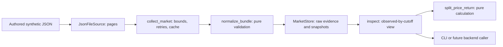

# Milestone 3 — Historical market-data foundation

Milestone 3A — Offline Market Data Infrastructure — is **complete and approved on 2026-10-28**, following baseline `a0a48f1`. **Live market-data integration remains incomplete.** No paid service, account, billing details, new dependency, dashboard, valuation model, AI or trading function was added. All observations in versioned fixtures are invented, labeled synthetic and unrelated to real AAPL/MSFT prices.

All six findings in Gemini's complete Milestone 3 review have been independently verified; accepted, rejected and deferred findings are recorded in [MARKET_DATA_REVIEW_RESPONSE.md](MARKET_DATA_REVIEW_RESPONSE.md). The user has approved finalization of the offline milestone.

## Provider decision and delivery boundary

[MARKET_DATA_PROVIDER_DECISION.md](MARKET_DATA_PROVIDER_DECISION.md) compares current official documentation and terms. Alpaca Basic is the preferred technical candidate, conditional on account/jurisdiction, feed entitlement and retention clarification. Twelve Basic is a daily-price alternative with a paid separate action ledger. Neither is enabled by this implementation. The user's explicit fallback authorizes a provider-independent offline foundation when material conditions remain unresolved.

No recognized Alpaca, Twelve Data or EODHD credential configuration was found (names checked without printing values). No authenticated AAPL/MSFT request was attempted; live validation remains **incomplete**, also subject to the unresolved rights gate. An API key or fixture-label boolean does not establish permission. The current source accepts only authored synthetic input; it is not an importer for downloaded provider responses or a switch for enabling real data.

## Existing architecture and compatibility

The repository has a standard-library Python package under `src/investor_ai`, not a database-backed application. `storage.Store` uses SHA-256 raw JSON objects, immutable company snapshots, atomic file replacement and a POSIX collection lock; there is no existing SQLite/ORM abstraction. `Collector` coordinates SEC requests and seven-metric extraction. `SecClient` enforces SEC-specific hosts/identity/rate policy. `financials` parser version 3 preserves financial observations; `analysis` version 2 is pure Decimal calculation, with `analysis_store` an offline snapshot adapter and reviewed evidence links.

Milestone 3 reuses the atomic byte/JSON writers and owns a nonblocking POSIX market collection lock, reporting `MarketDataError` on contention. SEC's lock and `SecError` contract remain unchanged. It adds separate market modules and a `market` CLI dispatch. It does not generalize SEC's host policy, mutate SEC snapshots, add price/share tags to its metric registry, or change the financial calculation engine. CIK identifies an issuer; it is not a security/share-class/listing identifier. The initial market instrument model therefore carries an explicit instrument ID, symbol, MIC, currency, timezone and optional issuer CIK. Its mapping is supplied evidence, not a historical security master.



## Models and interfaces

| Module/interface | Implemented contract |
| --- | --- |
| `market_data.normalize_bundle(bundle, observed_at=...)` | Pure validation/canonicalization; decimal strings, explicit dates/calendars, adjustments/actions, content IDs and quality diagnostics. Does not mutate inputs or perform I/O. |
| `market_store.JsonFileSource(path)` | Reads a bounded authored synthetic bundle. Exposes header, source fingerprint and `fetch_page(start,end,token) -> bytes`; traverses authored pages and filters the requested interval. No network/authentication. |
| `market_store.collect_market(source, store, ...)` | Single locked collection, bounded pagination and retries, request throttling, correction overlap, content verification, source-page provenance and atomic snapshot publication. Injected source/clock/sleep form the test seam. |
| `market_store.MarketStore.inspect(identifier, as_of, provider, feed, adjustment, adjustment_as_of)` | Offline view from the latest eligible **published** snapshot in one unambiguous series. Returns bars/actions, original evidence, version counts, exact cutoff and quality metadata. |
| `market_data.split_price_return(bars, actions, start, end, as_of, action_coverage)` | Split-corrected raw-price return with compatible evidence and complete observed action coverage; refuses unsupported inputs and excludes dividends. |

Bundle schema is demonstrated completely in `tests/fixtures/market_data.json`: `schema_version=1`, `synthetic=true`, provider/feed, instrument, adjustment/mode anchor, requested price coverage, explicit action coverage/completeness, an evidenced calendar interval with open/close timestamps, and paginated `bars`/`actions`. Decimal strings avoid float conversion. Zero volume is preserved, not inferred from absence; non-flat prices at zero volume generate `zero_volume_price_movement_sessions` for feed-specific investigation. The primary US-stock fixture now has positive volume; separate tests cover zero-volume inputs. There is no universal all-feed flatness rule. Modes `raw`, `split`, `dividend`, `all` remain distinct. `all` has no universal provider meaning; no future provider may use this normalized label without recording/reconciling its exact semantics (Alpaca can include spin-offs).

Every normalized record has financial content ID, observation timestamp, original page index, provider/feed/instrument/currency/adjustment metadata and, after collection, the raw source reference and observation-occurrence ID. The latter distinguishes A→B→A revisions without discarding the final A. Bars have market-session dates and OHLCV; events have provider-independent IDs, kind, ex-date, new/old split ratio or cash amount, and optional declaration/publication/payment dates. No payment or ex-date is invented. Provider process dates and historical symbol mappings need future adapter-specific models; they must not be silently equated with ex-date or a knowledge cutoff.

## Storage, incremental updates and recovery

Default ignored store: `data/market`, separate from `data/sec`. Global CLI `--data-dir` overrides it; SEC's `watchlist.toml` storage path does not silently redirect market data.

```text
data/market/
  raw/<sha256>.json              # Fetched synthetic pages and source header
  normalized/<sha256>.json       # All retained observation occurrences
  datasets/<series-hash>/snapshots/<uuid>/manifest.json
  datasets/<series-hash>/latest.json
  datasets/<series-hash>/status.json
```

Series identity includes instrument metadata, provider, feed, mode and adjustment anchor. Raw and adjusted histories, feeds and rebases cannot silently overwrite one another. Manifests contain versions, hashes, source references, original retrieval times, completion time and previous-published snapshot ID. Readers follow the published chain; an interrupted unpublished snapshot is never queryable. Source/normalized checksums are verified on query and cache hits. Atomic replacement protects process-interruption publication; hardware power-loss durability and hostile editing of manifests are not claimed.

Unchanged sources can hit a 24-hour cache without advancing data age. Otherwise collection rechecks a default **seven-calendar-day** overlap against the prior covered end, merges new observations, retains revisions and deduplicates only consecutively unchanged data. `--refresh` requests the complete supplied source interval. Source-supplied timestamps cannot backdate import availability. Retries and pages share a bounded per-run request budget; the default limiter is two calls/second, with bounded transient retries/cooldowns. These are tested source-adapter behaviors, **not** implemented HTTP handling, durable provider-wide quotas or live rate-limit compliance. No network adapter exists yet.

Each new action-completeness assertion is clipped to the **actually fetched window**. `merge_action_coverage` preserves independently evidenced complete windows and their original timestamps, IDs and raw-source references under `action_coverage.windows`. `coverage_covers` validates their fingerprints and tests continuous coverage of a requested interval. Overlapping and adjacent calendar-date windows preserve earlier history through repeated incremental updates. Unverified gaps are never bridged by minimum/maximum dates, holiday assumptions or an empty response. A narrower verified component can support a return while the whole series remains incomplete.

New incomplete requests conservatively invalidate overlapping current coverage and affected old ex-dates of known revisions. Other verified windows and all earlier snapshots survive. Later complete reconciliation can restore a gap only from its actual observation time onward. Missing known events in an asserted complete request still fail closed. No provider correction horizon is assumed; completeness remains an auditable source assertion, not a mathematically established guarantee of all market events.

Market normalizer version **2** adds this evidence-window tracking. It does not rewrite old snapshots or reuse version-1 cache hits as new normalized results. An old flat proof establishes only its retained interval; lost historical claims are not inferred from the old price bounds. Use a full refresh or audited migration where necessary.

Removed calendar sessions or a known action disappearing from an asserted complete refreshed range fail closed pending reconciliation. Missing refreshed bars preserve earlier observations at their old observation time and are flagged in `unconfirmed_refresh_sessions`; absence alone is not a retraction or a manufactured current price. Explicit event cancellation/bar retraction protocols and complex corporate reorganizations remain unimplemented.

## Financial and historical interpretation

Session date, publication time, actual observation/import time, snapshot completion and adjustment anchor are distinct. A cutoff requires already-observed records and a completed snapshot. Dates before collection are unavailable even for older price dates. Current back-adjusted history cannot be queried as though that representation was observed before collection. Alpaca's future `asof` parameter is for symbol mapping, not our `as_of` knowledge cutoff; see the provider decision.

For example, a bar for a 2024 session with a reported 2024 publication time, first retrieved here in 2026, remains unavailable to a 2024 `as_of` query. Inspecting it with a current cutoff analyzes historical market dates using current evidence; it does not certify a 2024 trading simulation. No reconstruction/bypass mode or new historical range-filter interface was added by this review.

Explicit calendar evidence supplies timezone-aware opens/closes; bars cannot precede their session close. No weekday-only holiday guesser fills gaps. Calendar missing sessions, early closes and zero volume remain distinct. Fixture calendars demonstrate these cases but are **not** a production exchange calendar service. A complete future calendar must include the relevant exchange's holidays, extraordinary closures, listing life and session definition; [NYSE's official hours/calendar](https://www.nyse.com/markets/hours-calendars) is an example of primary validation evidence (accessed 2026-10-28).

For raw endpoint closes and split ratios expressed as **new shares / old share**:

`price_return = end_close × product(split_ratios with start < ex_date ≤ end) / start_close − 1`

The invented example is `53 × 2 / 100 − 1 = 0.06` (6%). A 0.5 reverse split applies the same convention. Latest eligible action revisions are selected before filtering effective dates; moving an event outside the return interval must remove its effect. Return calculation requires complete, series-bound observed action evidence and compatible raw endpoints. Dividends may be present in provenance but are excluded from this formula. This is **not total return**, a reinvestment model or a forecast. Provider-adjusted prices are preserved as supplied representations; no local dividend-adjusted OHLCV or return series is fabricated.

Payment dates are validated as dates but not required to follow ex-dates: legitimate large special dividends can have an ex-date after payment. These records are preserved. Due-bill entitlement modeling is not implemented. Compounded splits and exact start/end boundaries are regression-tested; repeating ratios use their reported finite Decimal representation rather than an exact arbitrary rational model. See the review response for primary sources and future Alpaca endpoint/cursor/taxonomy requirements.

Historical shares outstanding, daily market capitalization and valuation ratios are deliberately absent. Period-weighted EPS shares differ from date-specific shares; CIK can span multiple classes. Computing these metrics requires separately evidenced class/date/share definitions, currency, split basis and filing availability. No price or current survivor list can supply that missing evidence. Ticker-change security-master reconstruction, terminal delisting proceeds, total returns, valuation, dashboard, portfolio/ML/AI and trading remain deferred.

## Usage and reproducibility

From the repository root, without API keys or network:

```sh
export PYTHONPATH="$PWD/src"
python3 -m investor_ai market collect --source tests/fixtures/market_data.json
python3 -m investor_ai market inspect SYNTH --json --limit 0
python3 -m investor_ai market inspect SYNTH
python3 -m investor_ai market collect --source tests/fixtures/market_data.json --refresh
python3 -m investor_ai market collect --provider alpaca
```

The final command intentionally returns nonzero with the unresolved integration gate; it does not contact Alpaca. `--as-of` accepts inclusive UTC dates or aware timestamps, `--adjustment` selects an explicit series, and `--adjustment-as-of` disambiguates anchors. Symbol ambiguity requires provider/feed/anchor selection or explicit instrument identity. JSON contains all provenance; text clearly labels synthetic data. Applications can call the same retrieval/pure interfaces without the CLI.

## Validation, independent review and acceptance

Run `PYTHONPATH=src python3 -m unittest discover -s tests -v`. Tests are offline and deterministic. They cover parsing, financial types/units, raw/adjusted separation, forward/reverse splits, dividends, session gaps/duplicates, holidays/early closes/DST, invalid prices/volumes, pagination loops/budgets, retries/cooldowns, cache/raw/normalized integrity, observation revisions, historical cutoffs, interrupted publication, independent feeds/bases, offline CLI and the existing 122-test regression baseline.

Independent code review identified and reproduced four defects before correction: effective-date action revisions were filtered too early; content deduplication lost A→B→A observations; incremental windows overstated action completeness; completeness evidence lacked series identity. Regression tests now guard these cases. Additional reproductions cover dropped same-series action records despite a complete assertion (evidence now references required event IDs), malformed error pages incorrectly treated as empty ledgers, and misleading partial-coverage CLI text. Retraction/calendar limitations above were made explicit and guarded.

**Review verification, 2026-10-28:** all **186 tests pass**: 122 unchanged Milestone 1/2 baseline tests, 29 initial pure market-domain tests, 17 initial collection/storage/CLI tests and 18 new review regressions. Both original SEC filing verifiers pass again offline (52 original current-period inputs plus eight comparatives, 48 independent formulas; 16 cumulative endpoints, 18 Q2/Q3/Q4 derived values and four direct quarter controls). Their persistence was disabled to retain original evidence timestamps. Independent re-review found no new critical window/PIT/revision issue. All six Gemini findings have documented dispositions in the review response.

A separate end-to-end check forbade DNS/connect calls, collected both fixture pages into an isolated temporary store, verified three bars/two actions and source hashes, computed the exact 6% price return, confirmed a cache hit retained the original snapshot, and inspected the CLI JSON. Its summary is saved in ignored `data/market/verification/offline_validation.json`. It made **zero network requests**. None of these results represents real-market accuracy or live AAPL/MSFT validation; that remains incomplete.

| Acceptance area | Status / remaining gate |
| --- | --- |
| Provider comparison, dated primary evidence, selection/tradeoffs | Delivered in provider decision; preferred future Alpaca conditional. |
| Modular daily prices, raw/adjusted representation, splits/dividends, identity/provenance | Working on authored synthetic fixtures; no real mapping/price entitlement validated. |
| Incremental storage, cache integrity, pagination, errors/rate behaviors | Offline-tested source interface and local persistence; live HTTP/daily quotas deferred. |
| Financial/PIT safeguards and offline reproducibility | Explicit observation snapshots, mode/basis separation and evidence-bearing split price return. No certified pre-collection history. |
| SEC/analysis compatibility | Existing modules/contracts preserved; run all baseline tests and both original-filing verifiers. |
| Real AAPL/MSFT collection and market quality reconciliation | **Incomplete**: no configured market credentials and unresolved provider rights; fixture results are not live validation. |
| Full Milestone 3 live integration | **Not complete**. Requires cleared rights, one real adapter, provider calendar/action semantics and limited authenticated reconciliation; no paid fallback. |

Subsequent work, requiring a separately authorized scope: resolve exact free account/feed/retention permissions; authorize and implement one provider adapter with source-specific daily budgeting; validate AAPL/MSFT bars plus real split/dividend examples and session calendar; then consider shares/valuation integration and dashboard under separate scopes. Lack of evidence remains a documented gap, not implied permission or a completed live feature.

The [final Milestone 3A adversarial integration validation](MARKET_DATA_ADVERSARIAL_VALIDATION.md) passed with no production-code correction required. It adds one integrated scenario covering six published snapshots, multiple actions/corrections, incomplete evidence, two real process exits and restart, independent rational financial references and historical replay with network access disabled. The current full suite is **187 passing tests** and both SEC filing verifiers pass. The **offline** foundation is approved for finalization; existing live-data and financial limitations remain in force.
