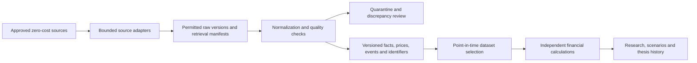

# Phase 1 research — Data engineering and research frameworks

Research date and link access date: **2026-10-27**. Status: proposed recommendations for review, not approved implementation decisions. This workstream inspected first-party documentation, repositories, source code, and Context7 documentation excerpts. It did not install packages, create accounts, benchmark libraries, or test provider uptime or authenticated data endpoints. Provider quotas and licenses must be rechecked when an integration is approved.

## 1. Findings and recommended direction

Recommend a small local Python research system with permitted raw-source snapshots, a provenance catalog, explicitly versioned normalized datasets, and independently testable calculations. DuckDB with Parquet is a suitable candidate for local analytics; a second database is optional. pandas supplies tabular transformations, while SciPy/statsmodels can support subsequent numerical work. Evaluate EdgarTools as an optional SEC parser, while retaining the SEC's original response and filing as reference evidence. These are architectural recommendations; no dependency or database has been installed or selected by implementation.

An open-source financial package is not a free financial-data license. FinanceToolkit and OpenBB can orchestrate data acquisition, including services with paid subscriptions or restricted use. yfinance's open-source license does not authorize unrestricted use of Yahoo data. Restrict any future acquisition to an explicit provider allowlist; do not let library defaults silently switch providers. The current [FinanceToolkit README](https://github.com/JerBouma/FinanceToolkit#readme) documents default FMP acquisition and automatic Yahoo fallback; the [OpenBB README](https://raw.githubusercontent.com/OpenBB-finance/OpenBB/develop/README.md) describes integrating public, proprietary, and licensed sources; the [yfinance README](https://github.com/ranaroussi/yfinance#readme) states its lack of affiliation with Yahoo and points users to Yahoo's terms for data-use rights.

## 2. Software comparison

All local open-source uses below can run without a financial-data subscription, card, trial, or hosted account. This is about software use: accessing external data remains subject to separate source terms. Local calculation libraries have no provider-style history, refresh frequency, authentication, or request quota; those properties are inherited from inputs. No library below supplies a certified point-in-time dataset merely by being installed.

| Candidate | First-party evidence and software license | Appropriate role | Maintenance evidence observed | Costs, dependencies, and limitations | Recommendation |
| --- | --- | --- | --- | --- | --- |
| DuckDB | [MIT/free-version FAQ](https://duckdb.org/faq); [Parquet documentation](https://duckdb.org/docs/2.0/data/parquet/overview) | Embedded analytical SQL; query permitted Parquet or a persistent local database | Current docs resolve to 2.0; published documentation and source maintained by the project | No hosted account or external data included. In-process read/write concurrency is within one writer process. Other remote coordination modes exist, but add infrastructure. | Strong local analytics candidate. Start with one writer and reproducible read jobs. |
| Apache Arrow / PyArrow / Parquet | [Python documentation](https://arrow.apache.org/docs/python/index.html); [Apache-2.0 license and bundled notices](https://raw.githubusercontent.com/apache/arrow/main/LICENSE.txt) | Typed columnar interchange and persisted normalized tables | Python documentation identifies v26.0.0 | No market-data feed; source licensing follows data. Storage format alone supplies neither transactions across arbitrary files nor historical vintage semantics. | Suitable companion where needed; use an explicit schema and snapshot manifest. |
| SQLite | [Public-domain dedication](https://sqlite.org/copyright.html); [appropriate uses](https://sqlite.org/whentouse.html) | Small local source/run/catalog metadata store | Current official maintained documentation; release cadence not audited here | Embedded local use needs no account. Keep local transactional metadata separate from large analytical scans if both are needed. | Optional; avoid adding it if a single DuckDB catalog is enough. |
| pandas | [BSD-3-Clause license](https://github.com/pandas-dev/pandas/blob/main/LICENSE); [time series guide](https://pandas.pydata.org/docs/user_guide/timeseries.html) | Normalization, explicit joins, fiscal/time/currency alignment | [3.1.0 release notes](https://pandas.pydata.org/docs/whatsnew/index.html) dated 2026-10-22 | No data rights supplied. In-memory processing may become a limit; measure before adding alternatives. Defaults and dtype/timezone changes require version-pinned regression fixtures. | Strong initial transformation candidate. |
| SciPy | [Official project and BSD license link](https://scipy.org/) | Optimization, root finding, distributions, numerical methods | Project advertises 1.18.1, released 2026-08-21 | Local numerical algorithms do not validate model assumptions or calibrate themselves. Input data and domain conventions remain our responsibility. | Add only when a specific calculation needs it. |
| statsmodels | [Official documentation and modified BSD license](https://www.statsmodels.org/stable/index.html); [release history](https://www.statsmodels.org/stable/release/index.html) | Statistical baselines, time-series models, estimation, diagnostics | Documentation identifies 0.15.0 dated 2026-08-27 | No free price feed or strategy guarantee. Date ordering, vintage selection, feature construction, train/test separation, and multiple-testing controls remain external responsibilities. | Good later baseline before complex ML. |
| EdgarTools | [MIT license](https://raw.githubusercontent.com/dgunning/edgartools/main/LICENSE.txt); [project README](https://github.com/dgunning/edgartools#readme); [SEC compliance documentation](https://github.com/dgunning/edgartools/blob/main/docs/resources/sec-compliance.md) | Parse SEC filings and XBRL; optional caching and form-specific models | Current project README and maintained source/doc tree inspected; no installed-version compatibility test | Local package needs no vendor subscription. SEC identity and access limits still apply. Standardization, inferred quarters, and TTM values are transformations, not original reported facts. | Evaluate against raw SEC API and original filing fixtures before adoption. |
| FinanceToolkit | [MIT license](https://github.com/JerBouma/FinanceToolkit/blob/main/LICENSE.txt); [source controller](https://github.com/JerBouma/FinanceToolkit/blob/main/financetoolkit/toolkit_controller.py); [DCF source](https://raw.githubusercontent.com/JerBouma/FinanceToolkit/main/financetoolkit/models/intrinsic_model.py) | Transparent ratio/model reference, including externally supplied statements | Current Python source, tests, and [project metadata](https://github.com/JerBouma/FinanceToolkit/blob/main/pyproject.toml) inspected; no release cadence or runtime audit | Custom price/balance/income/cash inputs are supported. Automatic remote acquisition can use FMP/Yahoo; quota, license, currency conversion, and calendar labeling depend on that path. | Candidate calculation reference on approved local inputs; acquisition must remain under project control. |
| QuantLib | [Modified BSD license](https://www.quantlib.org/license.shtml); [project scope](https://www.quantlib.org/); [Python distribution](https://www.quantlib.org/download.shtml) | Instrument valuation, term structures, quantitative risk and convention handling | Current project/docs and official Python binary distribution path inspected | Core is C++ with Python bindings; not a fundamentals database. Calibrations require market inputs that may not be free. Existing native dependencies do not justify new custom native code. | Defer until an instrument or convention requires it; excessive for the first company-fundamental pipeline. |
| OpenBB Open Data Platform | [Current develop-branch Apache-2.0 license](https://raw.githubusercontent.com/OpenBB-finance/OpenBB/develop/LICENSE); [README](https://raw.githubusercontent.com/OpenBB-finance/OpenBB/develop/README.md); [releases](https://github.com/OpenBB-finance/OpenBB/releases) | Optional later provider orchestration/integration surface | Current source and published release history inspected; repository URL redirects to `openbq-org/OpenBB` | Some connectors depend on paid or restricted sources; open-source tooling and hosted Workspace are different offerings. Verify license for the chosen release rather than repeating historical AGPL descriptions. | Defer broad integration framework until several explicit adapters justify it. |
| yfinance | [Apache-2.0 project](https://github.com/ranaroussi/yfinance#readme); [release history](https://github.com/ranaroussi/yfinance/releases) | Unofficial Yahoo access wrapper for carefully scoped exploratory research | Published release history and current README inspected | Maintainer explicitly says unaffiliated and intended for research/education, with Yahoo API personal-use caveat. No provider SLA or unrestricted retention/automation rights established. Current README notes price adjustment by default. | Not an approved autonomous production data backbone; underlying access/retention permissions need independent resolution. |

Versions above identify documentation observed on the research date, not a tested compatibility matrix or a promise of latest compatible releases. Phase 2 must pin a supported set and inspect licenses of chosen releases and transitive dependencies.

DuckDB documents filter/projection pushdown for Parquet and a direct file-query interface, supporting the local-storage recommendation without requiring a service. Its [concurrency documentation](https://duckdb.org/docs/2.0/connect/concurrency) distinguishes simple in-process operation from separately coordinated remote modes; start with the former. This is a fit judgment, not a measured performance conclusion.

FinanceToolkit's DCF source explicitly distinguishes cash flows to the firm from cash flows after interest, requires WACC above perpetual growth, and separates enterprise and equity adjustments. This is useful reference material, not proof that any supplied cash-flow field, capital structure, or discount rate is correct. Independently validate the chosen model and the mapping from source statements before using its results. [DCF implementation and assumptions](https://raw.githubusercontent.com/JerBouma/FinanceToolkit/main/financetoolkit/models/intrinsic_model.py).

## 3. API, license, and retention governance

Keep a source registry per endpoint/product, not just per company. Record verified free cost, absence of required payment details/trials/automatic charges, permitted purposes, account/key requirements, rate and daily quotas, endpoint weights, geographic/asset limits, attribution, retention, redistribution, and evidence URL/access date. An unspecified term is an unresolved condition, not permission. Provider limits can vary by endpoint, user, IP, plan, or symbol universe.

Before a source is enabled, decide whether the allowed use covers unattended local analysis and whether original responses may be kept long enough to reproduce research. Where raw retention is forbidden, store only permitted metadata/derived outputs and document the resulting reproducibility limit. Keep credentials out of manifests/logs. Hashes identify bytes; they neither grant a license nor restore deleted source content.

The SEC documents free public downloads, a **maximum of 10 requests/second**, declared contact identity in the user agent, and efficient scripting. Treat that as an upper bound rather than a target; coordinate the budget across all local workers, wrappers, and jobs contacting SEC. SEC can throttle further. [SEC accessing EDGAR policy](https://www.sec.gov/search-filings/edgar-search-assistance/accessing-edgar-data).

**FRED/ALFRED requires a material exception to the proposed cache-first design.** Independently inspected current [FRED full terms](https://fred.stlouisfed.org/legal/) include General Prohibitions (p) against storage/cache/archive without prior written consent; API Prohibitions (k) address software/AI development or training and (l) prohibit storage/cache/archive; MCP Prohibitions (k) also restrict storage/cache/archive. MCP-specific host-platform provisions do not establish permission for this project's persistent research database. The separate [API documentation terms page](https://fred.stlouisfed.org/docs/api/terms_of_use.html) omits these express restrictions, so relying on that page alone would miss a consequential conflict. Treat FRED/ALFRED as **not approved for durable ingestion or model development** without a verified applicable permission/exception. Inspect and approve original statistical-agency access separately instead. No FRED observation payload was collected or persisted by this workstream.

Proposed adapter behavior: endpoint allowlist; shared per-provider throttling; bounded pagination/backfills; respect `Retry-After`; exponential backoff with jitter; conditional retrieval where supported; incremental checkpoints; validate successful bodies before caching; bounded retries and explicit stale/missing status. A cache hit must retain its source/vintage and must not acquire a fresh publication timestamp. Keep TLS verification enabled. An upstream failure must not silently redirect the request to a different financial-data provider.

## 4. Point-in-time availability and revisions

The SEC APIs return aggregate facts from multiple submissions and restrict aggregate concepts to standard taxonomies and whole-entity contexts. Its frames endpoint selects the last-filed fact closest to a calendar period; that is unsuitable as a historical vintage selector on its own. CompanyFacts supplies facts with filing references, but a successful response today is not a certified reconstruction of everything visible on an earlier date. Preserve original filing and accession metadata and verify transformations against it. [SEC API documentation](https://www.sec.gov/search-filings/edgar-application-programming-interfaces).

SEC documentation also describes post-acceptance corrections/deletions and different index rebuilding schedules. Therefore even an accession-index snapshot is not necessarily immutable at the provider. Record retrieved versions and lawful removal/correction handling instead of assuming a current archive equals the original historical archive. [SEC post-acceptance correction documentation](https://www.sec.gov/search-filings/edgar-search-assistance/accessing-edgar-data).

As a documented temporal-data reference, FRED's real-time period distinguishes what is known today from what was known in an earlier period; default queries generally use today. ALFRED-style retrieval needs explicit real-time bounds and series-specific vintage availability. The documented vintage-date endpoint lists dates of changed/new observations, excluding release dates without a data change. Date-level vintage metadata alone does not establish an intraday release time. This describes technical functionality, not permission to ingest or store the data; the legal restriction above takes precedence for recommendations. [FRED real-time periods](https://fred.stlouisfed.org/docs/api/fred/realtime_period.html), [vintage-date endpoint](https://fred.stlouisfed.org/docs/api/fred/series_vintagedates.html).

Proposed timing model:

| Field/concept | Meaning and rule |
| --- | --- |
| Observation/event time | Price bar session, accounting period, or macro period. Never a substitute for publication time. |
| Source publication/dissemination time | When this version became publicly available; retain original zone, precision, evidence, and possible bounds. Submission acceptance and public dissemination may differ. |
| Provider availability/vintage | When a specific provider exposed this version, if known. Retain revision identifiers or real-time validity intervals. |
| Retrieved/first observed time | When our pipeline actually obtained these exact bytes/version. Do not backdate it during historical imports. |
| Normalized/recorded time | When a parser/version created the normalized record; preserve lineage to the immutable permitted raw object. |
| Eligible decision time | An explicit analysis rule using available evidence and required latency. Historical public-information replay and actual observed-pipeline replay are different modes. |

Historical replay may use defensibly evidenced source/provider availability even when we downloaded the archive later; label this reconstruction mode and its assumptions. Actual-pipeline replay must also require that the version was ingested and processed by the decision time. If only a date or unknown publication time exists, use a documented conservative delay/exclusion policy suitable to the chosen strategy; do not invent an exact timestamp. A current-data snapshot only establishes prospective availability from its first observation onward.

Use a backward as-of join on eligible availability **within identifier, field, unit, period, and vintage context**, with an explicit freshness tolerance. pandas offers backward as-of matching, but it cannot infer correct financial eligibility; data must first be filtered to the permitted vintage and sorted as required. Avoid nearest/forward joins for predictor construction. [pandas merge_asof reference](https://pandas.pydata.org/docs/reference/api/pandas.merge_asof.html).

## 5. Conceptual local architecture

This is a proposed logical design, not a physical schema commitment or implementation task.

Start with local files plus one catalog. Keep raw documents/JSON/CSV separate from typed normalized tables and derived research runs. Candidate normalized storage is partitioned Parquet queried by DuckDB; choose partition granularity from actual workloads. A small SQLite operational catalog is optional, not a prerequisite. Do not add object stores, queues, distributed services, or remote database servers without a demonstrated need.

Recommended conceptual records:

- **Source and permissions:** endpoint, free tier, terms/access evidence, permitted retention and attribution, recheck date, credential reference outside data, quota configuration, enablement status.
- **Retrieval object:** request without secrets, response status/headers as permitted, retrieval UTC, payload hash and lawful local path, source version, parser version, completeness/pagination, content type, retrieval errors, retention/deletion policy.
- **Entity/security identity:** stable internal security ID, company ID, source identifiers (e.g. CIK), exchange/MIC, share class, symbol and valid-from/to history. A current ticker map must not define a historical universe.
- **Reported fact:** raw value and parsed numeric value, reported/estimate/projection class, taxonomy/tag, units/scaling/currency, instant or start/end period, fiscal label, duration, consolidated/segment dimensions, accounting standard, source filing/accession, availability precision and vintage, quality flags. A restatement is another version.
- **Market observation:** security/venue/session, timezone, OHLCV type, currency, raw/adjusted status, price adjustment version, source retrieval vintage, missing/trading-halt flags. Retain corporate-action announcement, ex, effective, record and pay dates separately where supplied.
- **News/event:** source event ID/URL, publication/update/retrieval times, permitted headline/metadata/content scope, corrected/retracted relationship, entity-match confidence, attribution. An article index does not license full text.
- **Research run:** hypothesis and invalidation conditions, input snapshot manifest, decision-time rule, code/config/dependency versions, metric definitions, model assumptions/scenarios, seed if relevant, outputs and limitations.

Keep currency conversion and price adjustments in separate, versioned transformations. Reported cash-flow values, diluted weighted-average EPS shares, and point-in-time shares outstanding are not interchangeable valuation inputs. Preserve both original fiscal periods and any calendar-normalized labels; retain decimal values/scales rather than accidentally rounding during storage. Keep missing, inapplicable, and zero distinct.

## 6. Validation and independent checks

These are proposed Phase 2 acceptance checks; none is represented as executed here.

| Layer | Meaningful check | Failure treatment |
| --- | --- | --- |
| API contract | Detect endpoint entitlement errors, HTML error bodies in HTTP 200 responses, truncation, pagination omissions, duplicate batches, schema shifts and unexpected data loss | Quarantine response; preserve error and checkpoint; do not publish an apparently complete dataset |
| Facts | Reconcile selected reported values to original filings, including accession, unit, scale, dimensions and fiscal duration; use independent arithmetic checks | Preserve both values and explain the discrepancy; no blind averaging or silent source precedence |
| Accounting | Balance-sheet identity with appropriate tolerances and definitions; cash rollforward including FX/other adjustments; weighted-average shares and EPS context | Flag definition/taxonomy or parsing errors; accounting exceptions need explanation |
| Ratios/valuation | Hand-worked examples and independent formulas; zero/negative denominators; FCFF/WACC versus FCFE/cost-of-equity consistency; terminal growth and dilution | Reject or explicitly label unsupported results rather than emit false precision |
| Prices/actions | Compare comparable raw bars on same venue/session/currency; reconcile split factors and dividends to primary announcements where possible | Record adjustment-policy differences separately from data errors; do not silently overwrite |
| Time | A later restatement, macro revision, news correction, or security rename must not alter an earlier reconstructed dataset unless its snapshot definition changes | Fail the point-in-time gate; retain original run manifest |
| Universe | Identify absent/dead securities and historical membership uncertainty; current listings cannot prove historic coverage | Limit claims and exclude unsubstantiated survivorship-free backtests |
| Reproduction | Rerun from permitted pinned raw inputs offline; compare normalized values and research results | Document tolerances and environment; any unavailable raw data weakens reproduction claims |

Cross-source agreement is only useful after aligning definitions and provenance. Two wrappers may repeat one upstream source and provide no independent validation. A second source using adjusted annualized EPS is not a direct check of unadjusted quarterly EPS. Rank original disclosures as evidence of reported results, but retain the distinction between a correctly transcribed report and an economically comparable metric.

## 7. Practical Phase 2 sequence

1. **Approve a narrow initial research universe and data-use scope.** Recheck zero-cost eligibility, unattended-use and retention permissions for each endpoint. Specify research frequency and acceptable delays. Proceed only with sources whose relevant permissions are established.
2. **Write minimal reproducible fixtures and temporal conventions.** Choose a small set of SEC filers with different fiscal calendars, an amended/repeated fact, a macro series with revisions, and permitted corporate-action examples. Include known expected values from original disclosures.
3. **Build one bounded source adapter and provenance store.** Prefer official SEC JSON plus original filings for the first fundamentals slice. Verify identity, coordinated throttling, idempotency, pagination, restart and error behavior. No broad market crawler.
4. **Normalize and verify reported facts before deriving ratios.** Preserve raw tags/dimensions, source precision, fiscal intervals, accessions, and source/publication/ingestion timing. Quarantine ambiguous mappings.
5. **Add approved original-agency macro sources and permitted announcement monitoring.** Make current versus historical-vintage selection explicit; snapshot permissible agency releases prospectively where historical vintages are unavailable. FRED/ALFRED ingestion is excluded unless the documented legal restrictions are resolved with applicable permission. Keep full-text storage disabled unless source rights support it.
6. **Evaluate an approved end-of-day price adapter separately.** Confirm history, corporate actions, licensing and stable IDs on a small universe. Restrict analysis when delisting, historic universe, or point-in-time adjustment coverage is missing.
7. **Implement a small local calculation layer.** Independently validate a few ratios and DCF scenarios on documented inputs before comparing library outputs. Defer broad frameworks until their benefits exceed dependency and hidden-acquisition costs.
8. **Publish a reproducible research example with gaps.** Pin input manifests, transformations, versions, availability rules and benchmark definitions. Run temporal leakage fixtures and a restart/offline-reproduction check. This is readiness for research, not evidence of trading profitability or authorization for execution.

## 8. Evidence limits and unresolved questions

- Documentation/release activity is evidence of maintained interfaces, not uptime, numerical correctness, API entitlement, quality of every field, or a long-term free-access guarantee.
- Chosen version compatibility, security behavior, transitive licenses, memory use and performance are not tested. This report proposes what Phase 2 should verify.
- No generic free framework repairs missing historical analyst consensus, delisting returns, exchange universe history, news ingestion timestamps, or proprietary data rights.
- Snapshots collected from now onward help future reproducibility; they cannot retroactively establish an earlier unknown vintage.
- This workstream has not independently established lawful automated access/retention for every unofficial market-price service; these remain conditional and must not be silently enabled through a library.

Context7 was used for DuckDB Parquet behavior, FinanceToolkit externally supplied datasets/model inputs, and EdgarTools identity/storage guidance. Primary links above allow independent checking of those excerpts. Evidence is limited to the documented capabilities and inspected source; no live financial-service integration was implemented.
